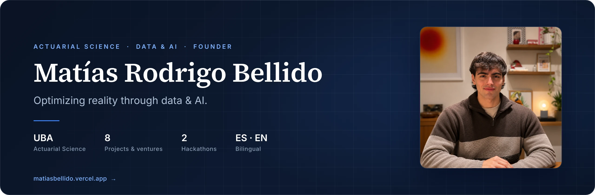

 

---

## Overview

Personal portfolio and professional presentation of **Matías Rodrigo Bellido**, Actuarial Science student at the University of Buenos Aires (FCE UBA). It brings together academic background, complementary training, and a selection of projects at the intersection of **data science, applied AI, and business operations**.

The site is built as a fast, fully responsive, bilingual (Spanish / English) single-page application, with a dark interface, glassmorphism surfaces, and electric-blue / cyan accents.

**Live:** [matiasbellido.vercel.app](https://matiasbellido.vercel.app)

---

## Highlights

- **Bilingual by design.** Full Spanish / English support through a typed translation dictionary, with the visitor's language preference persisted across sessions.
- **Fully responsive.** Layouts tuned from small phones to large desktops, including a horizontal scroll-snap carousel for project cards on mobile and a uniform multi-column grid on larger screens.
- **Polished motion.** Scroll-triggered reveals, text animations, and magnetic interactions built with Framer Motion, kept subtle and performant.
- **Unified project cards.** A single reusable card component and a data-driven structure: adding a new project only requires one metadata entry and its translations.
- **Detail modals.** Rich project views with image, description, tech stack, and external links (proposals, repositories, materials).
- **Statically optimized.** Next.js App Router with optimized images and automatic deployments on every push to `main`.

---

## Sections

| Section | Description |
|---|---|
| **Hero** | Introduction, positioning, and primary calls to action. |
| **About** | Background, focus areas, and approach. |
| **Experience** | Formal education and complementary training, organized by category. |
| **Projects** | Digital Solutions & AI, and Business Operations, presented as detailed case cards. |
| **Contact** | Direct channels and professional profiles. |

---

## Featured Projects

**Digital Solutions & AI**

- **Symbiosis AI** — Learning ecosystem that teaches university material through programming and real-world tooling. *In development.*
- **ZIRA** — AI financial reconciliation agent built in 24 hours at the Aleph Hackathon. On-device OCR and matching with privacy-first design on QVAC.
- **OneiricAi** — Dream reconstruction platform combining generative video with biometric data. Built at the SideQuest hackathon.
- **NutriOps** — Linear programming model that optimizes nutrition under budget constraints, fed by a supermarket price scraping pipeline.
- **NexStock** — Real-time multichannel stock synchronization for SMBs. Developed at the ITBA Entrepreneurs BootCamp 2026.
- **Budgents** — AI agent ecosystems for customer service automation, lead qualification, and scheduling.

**Business Operations**

- **Bellido Importaciones** — On-demand import service connecting the US market with local demand.
- **Bellido Asesoramientos** — Fitness coaching and educational advising with a data-driven, results-oriented approach.

## Contact

**Matías Rodrigo Bellido**
Buenos Aires, Argentina

- Portfolio: [matiasbellido.vercel.app](https://matiasbellido.vercel.app)
- GitHub: [@matiasbellidor](https://github.com/matiasbellidor)
- Email: [rbellidomatias@gmail.com](mailto:rbellidomatias@gmail.com)

---

© 2026 Matías Rodrigo Bellido. All rights reserved.

The source code is published for reference and evaluation purposes. Reuse of the design, content, or assets requires written permission.

